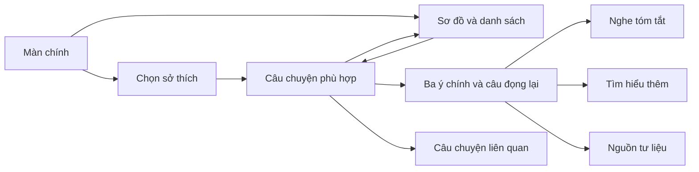

# Cồn Chim: thiết kế theo KT01

Ngày đối chiếu: 24/10/2026. Đây là bản triển khai đầu cho KT01, chưa phải kết quả kiểm thử với người được khảo sát.

Phần mở rộng theo tệp khảo sát KT02–KT07, QR cấu hình sau và các khoảng trống tư liệu được ghi tại [con-chim-personas.md](con-chim-personas.md). Các kết quả bên dưới mô tả mốc KT01 trước phần mở rộng đó.

Phần nhìn mới nhất theo UI tham chiếu của bảo tàng được ghi tại [con-chim-museum-ui.md](con-chim-museum-ui.md); không sửa trang bảo tàng.

## Bối cảnh đã xác nhận

Người dùng xác nhận ứng dụng đặt cố định như một màn hình tương tác để khách xem thông tin. Vì vậy, thiết kế ưu tiên thao tác chạm trên màn hình lớn, chữ dễ đọc và đường quay về rõ ràng. Responsive ở khung hẹp hỗ trợ giao diện chi tiết nhúng trong ứng dụng bản đồ; không coi điện thoại cá nhân là bối cảnh chính.

Thông số bổ sung đã xác nhận: màn hình lớn đặt **ngang, độ phân giải 4K**. Lấy 3840×2160 làm khung kiểm tra chính. Chưa có số inch, chiều cao lắp đặt hoặc khoảng cách đứng xem.

Design read: trang khám phá văn hóa cho khách dùng màn hình cảm ứng cố định, ảnh tư liệu và nhận diện xanh của dự án; ưu tiên lựa chọn trực tiếp và đọc nhanh. DESIGN_VARIANCE 5 / MOTION_INTENSITY 2 / VISUAL_DENSITY 4. Giữ Noto Serif và Be Vietnam Pro phục vụ nội bộ. Không thêm thư viện.

## Khảo sát giao diện trước khi sửa

- Màn mở đầu có ảnh thật và thương hiệu sẵn có, nhưng nút chính dẫn đến chương tổng quan trước khi khách chọn sở thích.
- Bộ điều khiển cuộn buộc đi qua bốn chương, bốn dấu mốc rồi mới đến các phần sau. Cách điều hướng này lệch nhu cầu đổi điểm ghé của KT01.
- Nội dung và CTA hướng nhiều đến lịch trình chuyến đi; studio tạo video là công cụ ngoài nhu cầu xem thông tin trên màn hình cố định.
- Có nguồn ảnh trong gallery và nguồn tại một số dấu mốc, nhưng chưa có một mẫu câu chuyện thống nhất gồm ý chính, đọc sâu và xuất xứ.
- Giữ: ảnh Cồn Chim đã có nguồn, màu xanh, phông chữ, iframe riêng và hợp đồng điều khiển với ứng dụng bản đồ.
- Thay: lộ trình cuộn bắt buộc bằng hai màn chọn tự do; các công cụ lịch trình/studio không nằm trong luồng KT01. Mã cũ giữ lại để tham khảo, không được tải từ entry hiện tại.

Ảnh khảo sát: `preview/con-chim-kt01-before.png`.

## Từ bằng chứng đến quyết định

| Bằng chứng KT01 | Quyết định trong bản này | Giả thuyết cần thử |
| --- | --- | --- |
| Thích món ăn, cảnh đẹp, chụp ảnh | Ba nút sở thích lớn ngay màn đầu, ảnh thật đổi theo lựa chọn | Khách nhận ra được điểm bắt đầu trong 10 giây |
| Muốn tự thay đổi điểm ghé | Sơ đồ chủ đề và danh sách; mở bất kỳ câu chuyện nào; nút liên quan là tùy chọn | Khách đổi chủ đề mà không cần người hướng dẫn |
| Không muốn đọc nhiều | Ba ý chính, một câu đọng lại, phần đọc thêm thu gọn | Sau khi đọc nhanh, khách nói được một liên hệ văn hóa |
| Lo tải lâu | Một ảnh chính, ảnh khác tải khi cần; ảnh lỗi không chặn chữ; không tự chạy media | Khách hiểu trang đang tải và vẫn tiếp tục được |
| Muốn đối chiếu thông tin | Nguồn tư liệu có ngay trong mỗi chuyện, gồm nguồn chữ, nguồn ảnh và ngày đối chiếu | Khách tìm ra căn cứ của điều vừa xem trong một thao tác |

Các mục tiêu thời gian trên là tiêu chí đề xuất để thử, không phải số đo từ nghiên cứu hiện có.

## Luồng đã triển khai

Sáu câu chuyện: bánh xèo, mâm cơm, ruộng và ao, đường làng, người dân, ngày đầu làm du lịch. Mỗi chuyện mở độc lập, không giả định khách đã xem phần trước. Đóng trả lại lựa chọn, vị trí cuộn và tiêu điểm; quay về màn chính đặt lại lựa chọn cho lượt xem mới. Dấu “Đã mở” chỉ tồn tại trong bộ nhớ của lượt xem, không khẳng định khách đã đọc hết.

Nguồn và nội dung phân biệt rõ tư liệu lịch sử với tình trạng dịch vụ hiện tại. Không tạo giá vé, giờ mở cửa, đánh giá hoặc vị trí hộ dân chưa xác minh.

## Các giới hạn cần kiểm tra cùng người dùng

1. **Sơ đồ:** chưa có tọa độ từng điểm được xác minh, nên đây là sơ đồ câu chuyện theo chủ đề, ghi rõ vị trí minh họa. Liên kết Google Maps dùng tọa độ Cồn Chim đang có trong dự án. Để làm bản đồ chỉ đường cần dữ liệu thực địa từng điểm.
2. **Nghe:** dùng giọng tổng hợp tiếng Việt của thiết bị, không phải giọng người dân. Chỉ phát sau thao tác; dừng khi đóng, đổi chuyện hoặc ẩn trang. Nếu chưa có giọng Việt, giao diện giải thích và giữ nội dung đọc. Cần thử loa/tai nghe và tiếng ồn ở địa điểm lắp đặt.
3. **Video:** nút mở phóng sự tại VTV chỉ xuất hiện trong nguồn của câu chuyện cảnh quan. Không nhúng hoặc tải video tự động. Nếu máy chạy chế độ khóa trình duyệt, cần quyết định cách cho phép mở nguồn ngoài hoặc xin video có quyền sử dụng để phát nội bộ.
4. **Kích thước:** đã xác nhận màn hình ngang 4K và có bố cục 3840×2160. Vẫn cần số inch, chiều cao lắp đặt và khoảng đứng thực tế để đánh giá cỡ chữ/vùng chạm. Kích thước CSS không chứng minh được khả năng tiếp cận trên phần cứng.
5. **Lượt xem mới:** có nút Màn chính đặt lại trạng thái, chưa tự hết phiên theo thời gian vì chưa có yêu cầu vận hành. Cần quan sát khách rời màn trước khi chọn cơ chế tự quay về.

## Tư liệu đã đối chiếu

- [Báo Đồng Nai, 21/04/2023](https://baodongnai.com.vn/dong-nai-cuoi-tuan/202304/con-chim-oc-dao-xanh-giua-dong-co-chien-cua-tra-vinh-3164132/): ghi nhận tại địa phương về món ăn và các hộ dân làm du lịch.
- [Bộ VHTTDL, 13/06/2022](https://bvhttdl.gov.vn/du-lich-tra-vinh-thuan-thien-de-phat-trien-ben-vung-20220610085916221.htm): sinh kế thuận thiên. Ngày trên trang là 13/06, khác ngày 10/06 trong đường dẫn.
- [Bộ VHTTDL, 10/09/2019](https://bvhttdl.gov.vn/ra-mat-diem-du-lich-cong-dong-dau-tien-tai-tra-vinh-20190910165212562.htm): quá trình hình thành và ngày ra mắt.
- [Người Lao Động, 19/02/2022](https://nld.com.vn/du-lich-xanh/trai-nghiem-mien-tay-hoang-so-o-con-chim-20220218214201686.htm): trải nghiệm và ảnh bữa cơm. Ngày hiển thị trên bài khác ngày trong đường dẫn.
- [VTV, 15/12/2024](https://vtv.vn/video/thuan-thien-710682.htm): phóng sự để xem thêm theo yêu cầu.

Ảnh lấy từ dữ liệu nguồn sẵn có của dự án, không sinh ảnh giả cảnh địa phương. Ngày đối chiếu không phải ngày chụp. Các câu hỏi gợi mở và lời nhắc ứng xử là phần biên soạn thiết kế, không gán thành lời nói của người dân.

## Buổi thử với KT01 đề xuất

Mời từng khách dùng màn hình mà không chỉ trước vị trí nút. Ghi thao tác, thời gian, chỗ ngập ngừng và lời khách diễn đạt; tránh hỏi dẫn dắt “giao diện có dễ dùng không?”.

| Nhiệm vụ | Quan sát |
| --- | --- |
| “Hãy chọn một điều khiến bạn tò mò về Cồn Chim.” | Lựa chọn đầu tiên; khách có hiểu nút sở thích đổi nội dung không |
| “Tìm hiểu nhanh món ăn đó có liên quan gì đến người ở đây.” | Có nói được mối liên hệ, không chỉ nhớ tên món |
| “Giờ bạn muốn xem một cảnh đẹp khác.” | Có đổi được qua danh sách/sơ đồ mà không mất phương hướng |
| “Bạn muốn biết thông tin này lấy từ đâu.” | Có mở đúng nguồn của câu chuyện đang xem |
| “Bạn đã xem xong; để màn hình cho khách tiếp theo.” | Có tìm thấy Màn chính và hiểu việc bắt đầu lại |

Thử thêm với mạng chậm, mất một ảnh, máy không có giọng Việt và tình huống hai người cùng xem. Chỉ sau buổi thử mới kết luận được trải nghiệm có đáp ứng KT01 hay chưa.

## Kiểm tra kỹ thuật

Entry: `/con-chim.html`; vẫn được nhúng bởi `ConChimZipDetail.tsx` trong bản đồ. Các lệnh host kiểm tra origin/source và danh sách hành động được cấp. Bridge xử lý ready, reduced motion, inert, focus trap, Escape và trả focus.

Chạy `node node_modules/typescript/bin/tsc --noEmit`, `npm run build`, `node tests/con-chim-kt01-test.cjs`. Các bộ `con-chim-timeline-test` và `con-chim-motion-test` mô tả giao diện cuộn tuần tự cũ nên không dùng làm tiêu chí của KT01. Xem kết quả kiểm tra thực tế trong cập nhật bàn giao.

Kết quả bàn giao ngày 24/10/2026:

- TypeScript và build thành công. Bộ kiểm tra KT01 qua trên bản production, không có exception trong trình duyệt.
- Kiểm tra chạm thật, lọc/chuyển chuyện tự do, mở rộng/nguồn, Escape và focus, giọng đọc mô phỏng, ảnh lỗi/thử lại, chủ đề tối và giảm chuyển động. Giọng đọc mô phỏng chỉ kiểm tra vòng đời phát/dừng, không thay thế việc nghe trên thiết bị thực.
- Màn đầu nằm gọn ở 1920×1080, 1440×960 và 1280×720. Kiểm tra thêm khung 768, 390 và 320 px không tràn ngang.
- Luồng ứng dụng bản đồ thật qua: quick view → chi tiết → thu/phóng giữ lựa chọn → QR → đóng. Tin nhắn khác origin không thay được các điều khiển host.
- Lighthouse 12.8.2 desktop tại localhost: performance 98, accessibility 100, best practices 100; LCP 1,0 giây, CLS 0,002. Báo cáo: `.browser-profile/con-chim-kt01-lighthouse.json`. Đây là phép đo môi trường thử; chưa đại diện máy lắp đặt hoặc mạng thực tế và không thay thế kiểm thử trợ năng với con người.
- Ảnh xem lại: `preview/con-chim-kt01-home.png`, `preview/con-chim-kt01-home-1280.png`, `preview/con-chim-kt01-reader.png`, `preview/con-chim-kt01-explore.png`, `preview/con-chim-kt01-integrated.png`.

## Bố cục màn hình lớn 4K

Khảo sát lại ở 3840×2160 cho thấy giới hạn chiều rộng 1700 px làm giao diện cũ nhỏ ở giữa màn hình. Bản 4K dùng kích thước bố cục và chữ theo viewport, không kéo giãn toàn trang bằng `transform` hoặc `zoom`.

- Tại 3840 CSS px: vùng nội dung màn đầu rộng tối đa 3400 px, chữ tóm tắt 42 px, chữ tên sở thích 46 px, nút thao tác chính cao ít nhất 112 px; ba lựa chọn sở thích lớn hơn mức tối thiểu này.
- Màn khám phá có sơ đồ bên trái và sáu câu chuyện theo hai cột bên phải; cả sáu lựa chọn hiện cùng lúc. Khi ẩn sơ đồ, danh sách chuyển sang ba cột.
- Cửa sổ câu chuyện mở rộng tối đa 2960×1840 px; chữ nguồn và vùng chạm cũng tăng cùng bố cục.
- Quy tắc màn lớn áp dụng khi viewport từ 2560 px và cao từ 1200 px; tỷ lệ tăng dần đến 3840 px. Trường hợp máy 4K dùng mức phóng 200%, viewport 1920×1080 tự dùng bố cục cũ để tránh phóng hai lần. Kiểm tra thêm viewport 2560×1440.
- Không thay ảnh tư liệu bằng ảnh sinh. Độ sắc nét ảnh vẫn phụ thuộc ảnh gốc; đánh giá trên màn lắp đặt cùng với cỡ chữ và khoảng đứng.

Kiểm tra riêng: `node tests/con-chim-kt01-test.cjs --4k`; kiểm tra tích hợp 4K: `node tests/con-chim-kt01-test.cjs --4k --host-only`. Thêm `--dev` để dùng Vite tại cổng 3000. Ảnh kiểm tra lưu ở `preview/con-chim-kt01-4k-home.png`, `preview/con-chim-kt01-4k-explore.png`, `preview/con-chim-kt01-4k-reader.png`, `preview/con-chim-kt01-4k-integrated.png`; ảnh trước khi sửa là `preview/con-chim-kt01-4k-before.png`.

Kết quả cập nhật 4K: build thành công; bộ kiểm tra 4K, tích hợp bản đồ 4K và kiểm tra giao diện cũ đều qua trên production. Thử chạm trực tiếp mở được câu chuyện thứ sáu và nguồn tư liệu. Luồng tích hợp dùng nút mở diễn giải của bản đồ để không phụ thuộc việc tải xong ảnh vệ tinh. Lighthouse với viewport 3840×2160, DPR 1: performance 98, accessibility 100, best practices 100; LCP 1,0 giây. Báo cáo riêng: `.browser-profile/con-chim-kt01-4k-lighthouse.json`. Đây vẫn là kiểm tra trình duyệt cục bộ, chưa phải kiểm thử trên màn hình vật lý.
