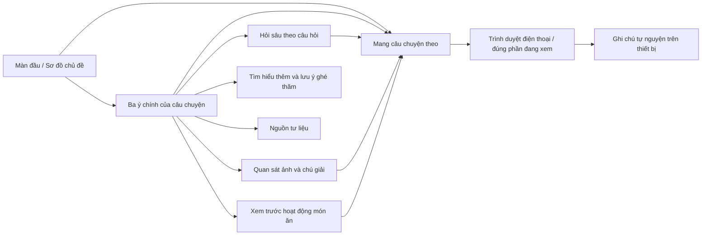

# Cồn Chim: mở rộng từ KT02 đến KT07

Ngày đối chiếu: 24/10/2026. Tiếp nối [KT01](con-chim-kt01.md), dựa trên toàn bộ tệp khảo sát người dùng cung cấp. Các quyết định dưới đây là giả thuyết thiết kế đã triển khai để thử, chưa phải kết quả kiểm thử với người tham gia khảo sát.

Theo phản hồi sau đó, phần nhìn đã được đổi theo UI Bảo tàng Văn hóa Khmer, giữ các chức năng bên dưới. Xem [bản cập nhật UI và kiểm tra mới nhất](con-chim-museum-ui.md).

## Bối cảnh và phạm vi

- Màn hình tương tác cố định, lớn, đặt ngang; kiểm tra chính ở 3840×2160. Chưa có số inch, chiều cao lắp đặt và khoảng cách đứng.
- Màn đầu phục vụ khách xem chung; điện thoại là phương án tiếp tục câu chuyện, không thay vai trò của màn hình.
- Giữ ảnh thật, màu xanh, phông chữ nội bộ, sáu câu chuyện và cơ chế nhúng trong bản đồ. Không thêm lựa chọn “bạn thuộc KT nào” vào giao diện.
- Nhóm yêu cầu về hiện vật bảo tàng, truyền thuyết Ao Bà Om và chi tiết chùa Khmer cần triển khai tại đúng trang địa điểm. Chúng không được gán thành nội dung Cồn Chim.
- Người dùng xác nhận chưa có website công khai: làm sẵn QR và cấu hình sau, không xuất bản trong đợt này.

## Từ khảo sát đến tương tác

| Nhóm | Nhu cầu áp dụng cho Cồn Chim | Đã triển khai | Cần bổ sung hoặc xác nhận |
| --- | --- | --- | --- |
| KT01 | Bắt đầu từ món ăn/cảnh đẹp, đổi chuyện tự do, ít chữ, kiểm tra nguồn | Màn chọn sở thích; sơ đồ chủ đề + danh sách; ba ý chính; nghe theo yêu cầu; nguồn ngay trong chuyện | Sơ đồ hiện là minh họa theo chủ đề; cần tọa độ thực địa để chỉ đường |
| KT02 | Hiểu sâu một chi tiết, xem trước làm món, tự quyết định thời gian | Ba câu hỏi độc lập mỗi chuyện; nguồn tại đáp án; ảnh có điểm chạm; thời lượng đọc ước tính; tạm dừng/tiếp tục nghe; mang đúng phần đang xem theo | Cần tên người hướng dẫn hiện tại, lịch đón và đoạn thao tác mẫu có quyền sử dụng |
| KT03 | Hình dung hoạt động và tự tin bắt đầu | Hai chuyện món ăn có phần xem trước: người hướng dẫn theo vai trò, nguyên liệu/dụng cụ, ba bước tự chọn, điều có thể nhận được; hướng dẫn thân thiện, không chấm điểm | Cần thử với khách chưa từng làm; bổ sung ảnh từng bước được chủ nhà duyệt |
| KT04 | Gắn câu chuyện với con người, biết cách ghé thăm và truy cập nhanh | Ví dụ người thật có nguồn báo chí; gợi ý ứng xử kèm lý do; câu hỏi quan sát; QR ở màn đầu và từng chuyện | Chưa có lời kể trực tiếp được cho phép; quy định cụ thể cần người phụ trách xác nhận |
| KT05 | Tự đọc, quan sát kỹ, suy ngẫm, lưu để đọc lại | Ảnh nguyên khung phóng 100–250%; bật/tắt chú giải; danh sách chi tiết độc lập; nguồn/loại tư liệu/ngày đối chiếu; câu hỏi suy ngẫm; ghi chú tự nguyện trên trang mang theo | Cần ký ức của người địa phương, bối cảnh ghi nhận, đồng ý sử dụng và người rà soát được xác nhận |
| KT06 | Ví dụ cụ thể, hoạt động liên quan, QR đúng chuyện, không tài khoản | Ví dụ Võ Văn Bé được báo chí ghi nhận, các câu hỏi về món ăn; liên kết tới phần xem trước; QR giữ chuyện/câu hỏi/điểm ảnh/bước; mở bằng trình duyệt | Ảnh nhóm không được gán là chân dung nhân vật; lịch và cách gặp người thực hành chưa được xác minh |
| KT07 | Hình ảnh dễ hiểu, hướng đi rõ, xem tiếp không cài ứng dụng | Điểm chạm trên ảnh có giải thích, ảnh lỗi vẫn đọc được; sơ đồ ghi rõ minh họa; liên kết web mở đúng nội dung | Video phụ đề cần file và quyền sử dụng; vị trí màn hình/lối vào/đường đi cần khảo sát thực tế; truyền thuyết và lịch sử Khmer thuộc trang tương ứng |

## Luồng nội dung



Phần sâu thay nội dung trong cùng cửa sổ, không chồng nhiều hộp thoại. Nút quay lại về tóm tắt; nút đóng về màn khám phá. Từ QR có thể trở lại đúng phần trước đó. Chọn chi tiết ảnh và bước hoạt động không bắt buộc theo thứ tự.

Thời lượng xem là ước tính đọc nội dung, không phải thời gian tham gia thực tế. Giọng tổng hợp do thiết bị cung cấp, không giả làm giọng cư dân. Có phát/dừng/tạm dừng/tiếp tục; đổi phần, đóng hoặc ẩn trang dừng âm thanh. Cần nghe thử trên phần cứng thực tế.

## Cơ sở nội dung và cách phân biệt

- **Tư liệu đối chiếu:** ghi nhận từ bài công khai; liên kết nguồn và ngày ngay tại đáp án. Ví dụ ngày ra mắt 9/9/2019 khác ngày đăng bài 10/9/2019.
- **Gợi ý hỏi trực tiếp:** câu hỏi hoặc cách bắt đầu cuộc gặp do người thiết kế biên soạn, không gán thành lời kể hoặc câu trả lời của chủ nhà.
- **Quan sát từ ảnh:** chỉ chú giải chi tiết thấy được trên ảnh hiện có; vị trí điểm chạm là tọa độ ảnh, không phải tọa độ địa lý. Không suy ra danh tính, ngày chụp hoặc mùa vụ.
- **Gợi ý ứng xử:** nêu hành động cùng lý do; không trình bày thành nội quy đã được địa phương duyệt.
- **Rà soát:** giao diện ghi ngày đối chiếu nội dung và việc chưa ghi nhận người phụ trách địa phương rà soát. Không tự điền người kể, đơn vị duyệt hoặc ngày quay/chụp.

Nguồn thêm ngoài KT01:

1. [Đoàn UBND tỉnh Vĩnh Long — Điểm du lịch cộng đồng Cồn Chim](https://doanubndvinhlong.vn/diem-du-lich-cong-dong-con-chim/): giới thiệu hoạt động làm bánh và sinh hoạt; không ghi ngày đăng.
2. [Cục Du lịch Quốc gia Việt Nam / Báo Cần Thơ — Trà Vinh: Ẩm thực cồn Chim](https://vietnamtourism.vn/index.php/news/items/26137): cập nhật 28/02/2023, ví dụ món ăn gắn với các hộ dân. Đây không phải danh mục dịch vụ hiện tại.
3. [Bài và ảnh Ca Linh / Người Lao Động — Trải nghiệm miền Tây hoang sơ ở cồn Chim](https://nld.com.vn/du-lich-xanh/trai-nghiem-mien-tay-hoang-so-o-con-chim-20220218214201686.htm): 19/02/2022, trường hợp ông Võ Văn Bé. Nội dung được tóm lược từ báo, không dùng như bản phỏng vấn trực tiếp.
4. [Bộ VHTTDL — Ra mắt điểm du lịch cộng đồng đầu tiên tại Trà Vinh](https://bvhttdl.gov.vn/ra-mat-diem-du-lich-cong-dong-dau-tien-tai-tra-vinh-20190910165212562.htm): 10/09/2019, mốc thử nghiệm và ra mắt.

Hiện chưa có file video kèm phụ đề hoặc bản thu của cư dân được xác nhận quyền sử dụng trong tư liệu dự án. Bản này dùng ảnh, chữ và giọng tổng hợp; phóng sự VTV vẫn là liên kết ngoài do khách chủ động mở. Không tạo video hay lời kể giả để lấp khoảng trống.

## QR: đã sẵn sàng, cấu hình địa chỉ sau

Thêm biến sau vào `.env.local` khi đã có trang công khai, dùng **URL đầy đủ của trang**, gồm cả thư mục triển khai nếu có:

```dotenv
VITE_CON_CHIM_PUBLIC_URL=https://TEN-MIEN-CUA-BAN/THU-MUC/con-chim.html
```

Đây là ví dụ cấu hình, không phải địa chỉ đang hoạt động. Sau khi đổi biến, khởi động lại Vite khi phát triển hoặc build và triển khai lại bản production. Không cần khóa API.

- Nếu bỏ trống và trang đang chạy trên một địa chỉ có thể truy cập được, liên kết dùng trang Cồn Chim cùng thư mục hiện tại. Đơn vị triển khai vẫn cần xác nhận điện thoại truy cập được địa chỉ đó.
- Nếu chỉ có localhost/loopback, giao diện có trạng thái chưa sẵn sàng; không vẽ QR giả hay trỏ điện thoại về localhost.
- QR dùng thư viện `qrcode`, sinh PNG ngay trên thiết bị, tải mã tạo QR khi mở phần mang theo; không gọi dịch vụ QR bên ngoài.
- Liên kết giữ `story`, `mode`, và câu hỏi/điểm ảnh/bước liên quan, cộng `portable=1`. Ví dụ đường dẫn: `/con-chim.html?story=banh-xeo&portable=1&mode=questions&question=nguyen-lieu`.
- Trang đích mở trực tiếp bằng trình duyệt, không cần đăng nhập hoặc cài ứng dụng. Có sao chép/mở liên kết nếu không dùng camera.
- Ghi chú chỉ hiện trong chế độ mang theo. Chỉ nút **Lưu** mới ghi vào localStorage theo câu chuyện; có nút xóa. Dữ liệu không tự gửi về máy chủ, không tự lưu khi gõ, không có ô ghi chú trong luồng màn hình dùng chung.
- Thao tác QR của khung bản đồ cho Cồn Chim mở thành phần QR này ngay trong iframe, giữ câu chuyện gần nhất. Không dùng mã trang trí trong hộp QR chung của các địa điểm khác.

## Vận hành và dữ liệu còn cần

Trước khi giới thiệu hoạt động như một dịch vụ đang nhận khách, cần xác nhận: người hướng dẫn; cách liên hệ tại điểm đón; món/thao tác thực sự có thể thử; thời lượng và lịch; phần được phép quay/chụp; lối đi và vị trí màn hình. Bản hiện tại không công bố lịch, giá hoặc tên người hướng dẫn chưa được xác nhận.

Với tư liệu mới, ghi tối thiểu: người kể/nhân vật; người ghi nhận; ngày và bối cảnh; loại tư liệu; quyền dùng hình/tiếng; văn bản/phụ đề; nguồn và người địa phương rà soát. Lời kể cá nhân cần giữ nhãn riêng với lịch sử đã đối chiếu. Cần xác định cách mở nguồn ngoài khi máy chạy trình duyệt khóa.

## Buổi thử tiếp theo với người đã khảo sát

| Nhiệm vụ không dẫn dắt | Quan sát cần ghi |
| --- | --- |
| “Chọn điều bạn muốn biết, rồi tìm một câu hỏi cụ thể.” | Có tìm được phần hỏi sâu; có hiểu nguồn và phần gợi ý hỏi người thật khác nhau không |
| “Bạn chưa làm bánh bao giờ. Hãy tìm cách bắt đầu phù hợp với mình.” | Có hình dung mình sẽ làm gì; có nhận ra phần cần chủ nhà hướng dẫn; còn ngại bị đánh giá không |
| “Hãy chỉ một chi tiết bạn muốn nhìn rõ hơn.” | Điểm chạm có đúng chỗ; phóng to/vuốt có dễ hiểu; đọc chú giải có mất vị trí không |
| “Bạn muốn biết điều này do ai nói và ghi nhận lúc nào.” | Có tìm đúng nguồn; có nhầm giọng tổng hợp với lời kể cư dân không |
| “Bạn cần rời màn hình nhưng muốn đọc lại đúng phần này.” | Có thấy nút mang theo; quét thành công trên điện thoại; đến đúng câu hỏi/chi tiết/bước |
| “Bạn muốn nhớ một ý của riêng mình.” | Có hiểu ghi chú là tùy chọn, lưu trên máy của mình và xóa được không |

Thử thêm với hai người đứng cùng xem, người đứng xa, âm thanh môi trường và mạng chậm. Cần đo trên màn hình vật lý để đánh giá độ dễ đọc, vùng với tay và phản xạ màn hình. Không dùng điểm Lighthouse làm bằng chứng khách hiểu văn hóa tốt hơn.

## Kiểm tra kỹ thuật

- TypeScript: `node node_modules/typescript/bin/tsc --noEmit`.
- Build Vite; kiểm tra luồng cũ bằng `node tests/con-chim-kt01-test.cjs`, thêm `--4k` cho màn lớn hoặc `--4k --host-only` cho khung bản đồ.
- Kiểm tra lớp mới bằng `node tests/con-chim-personas-test.cjs`: hỏi sâu, phân loại nguồn, vòng đời nghe, tọa độ ảnh khi zoom, ẩn chú giải, ảnh lỗi/thử lại, bước hoạt động, liên kết trực tiếp, lưu/xóa ghi chú, trạng thái localhost, QR thật và giải mã vòng lại, bố cục các chế độ ở 3840/1280/390/320 px.
- Bộ kiểm tra QR dùng tên `.test` chỉ ánh xạ về máy thử; không tạo website công khai. Giải mã PNG bằng Python/OpenCV/numpy, kiểm tra URL thực được mã hóa; đây không thay thế thử camera trên màn lắp đặt.
- Ảnh xem lại trong `preview/con-chim-personas-*.png`; báo cáo Lighthouse tại `.browser-profile/con-chim-personas-lighthouse.json`.

Kết quả ngày 24/10/2026:

- TypeScript và build production thành công; build dùng lại tài nguyên public đã có trong `dist` để tránh sao chép lại bộ ảnh bản đồ lớn.
- Bộ KT01 production, bộ lớp nội dung mới và tích hợp khung bản đồ ở 4K đều qua. Không ghi nhận exception chưa xử lý trong các luồng thử.
- QR PNG thật giải mã ra đúng câu chuyện/câu hỏi; trang đích khôi phục đúng phần đó. Liên kết chi tiết ảnh và bước hoạt động cũng được kiểm tra. Chưa có URL công khai; tên `.test` trong ảnh thử chỉ dùng nội bộ bộ kiểm tra.
- Năm chế độ đọc/hỏi sâu/quan sát/hoạt động/mang theo qua kiểm tra không tràn ngang tại 3840, 1280, 390 và 320 CSS px. Đã xem lại ảnh 4K của các lớp nội dung và trang điện thoại.
- Lighthouse 12.8.2 tại localhost, viewport 3840×2160, DPR 1: performance **97**, accessibility **100**, best practices **100**; LCP **1,1 giây**, CLS **0,001**. Đây là số đo trình duyệt cục bộ của màn đầu, không đại diện mạng hoặc phần cứng lắp đặt, cũng không chứng minh mọi luồng đã được kiểm thử trợ năng với con người.
